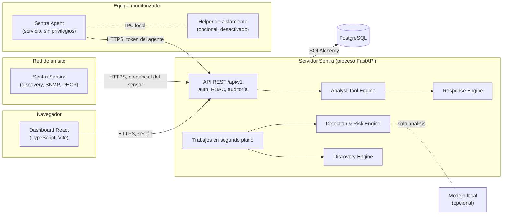

# Sentra

## 1. Qué es Sentra

Plataforma propia de monitorización de activos y eventos de seguridad en tiempo real. Sentra
inventaria los equipos de una red (con agente, con sensores distribuidos o sin agente), recoge
su telemetría y sus eventos, detecta comportamientos sospechosos, calcula el riesgo de cada
activo de forma explicable y da a los analistas las herramientas para investigar, abrir casos
y responder con un humano siempre en el bucle.

Sentra tiene su propio modelo de datos, su API y sus motores. Wazuh, Suricata, Syslog u otras
herramientas podrán conectarse más adelante como integraciones opcionales, nunca como núcleo.

## 2. Objetivo del proyecto

Crecer de forma verificable, por fases pequeñas, hacia un SOC empresarial instalable de forma
nativa (Windows y Linux, sin Docker): inventario fiable, detecciones explicables, riesgo
trazable, gestión de casos y respuesta controlada. Cada funcionalidad debe ser real y medible:
sin módulos de relleno, sin cifras simuladas y sin acciones automáticas sobre los activos.

## 3. Estado de desarrollo

Pre-1.0. La plataforma funciona de extremo a extremo con datos reales en el equipo de
desarrollo (equipo → agente → API → PostgreSQL → dashboard). Cada fase se entrega como un
parche revisable, se valida en Windows y se publica a mano. El estado detallado, las
decisiones y las limitaciones conocidas están en
[docs/DEVELOPMENT_STATUS.md](docs/DEVELOPMENT_STATUS.md).

## 4. Versiones por componente

Cada componente tiene su versión; no hay una versión global.

| Componente | Versión | Notas |
| --- | --- | --- |
| Servidor (backend) | 0.4.0 | API `/api/v1` |
| Frontend | 0.4.0 | Requiere servidor 0.4.0 |
| Agente | 0.6.0 | Compatible con servidores anteriores |
| Sensor | 0.7.0 | Compatible con servidores anteriores |
| Migraciones Alembic | 0047 | Siguiente libre: 0048 |

Cruces de versiones: [docs/compatibility-matrix.md](docs/compatibility-matrix.md).

## 5. Fase completada y fase en desarrollo

| Fase | Estado |
| --- | --- |
| 1-6E | Completadas y publicadas (inventario, detección, riesgo, IA local opcional, incidentes, producción, reglas Sigma, vulnerabilidades, threat intelligence, respuesta, informes, sensores, SNMP, topología, telemetría de endpoint, forense y aislamiento seguro) |
| **7A** | **Completada en esta entrega**, pendiente de validación en el equipo real: Analyst Tool Engine, inteligencia de dispositivos sin agente, hub Red, tareas y controles en los casos, gráficas del dashboard, contexto de PowerShell |
| 7B | Siguiente: consola del analista sobre el Analyst Tool Engine |
| 7C | Planificada: modelo local ("Rabanito") como cliente del mismo motor de herramientas, sin permisos implícitos |

## 6. Funcionalidades implementadas

**Inventario y red**

- Agentes Windows, Linux (systemd, `.deb`/tarball) y macOS con enrolamiento por token de un
  solo uso y credencial por agente; heartbeat, telemetría, inventario, procesos, eventos.
- Discovery sin agente limitado a redes autorizadas, sensores distribuidos por site, SNMP,
  LLDP/CDP, WLAN, identidad DHCP y topología con historial.
- Identificación de dispositivos por evidencias ponderadas (mDNS/DNS-SD, NetBIOS, SSDP/UPnP,
  OUI, DHCP, huellas HTTP y TLS); una marca o una MAC nunca deciden el tipo solas, y la
  etiqueta o el tipo manual de un admin mandan.
- Hub **Red** con Resumen, Dispositivos, Descubrimiento, Topología, Puertos y servicios,
  Historial de cambios, Identidad y evidencias, y Telemetría.

**Detección y riesgo**

- Motor de detección con reglas integradas y correlaciones, reglas personalizadas e importación
  Sigma, detecciones de comportamiento de endpoint y árbol de procesos.
- Excepciones exactas, auditadas y con caducidad; contexto de PowerShell (ruta, hash, proceso,
  causa del aviso) sin recoger el contenido de los scripts.
- Risk Engine explicable con ledger de contribuciones e historial; vulnerabilidades con
  catálogo local, NVD/OSV, KEV y EPSS; threat intelligence offline-first.

**Casos, análisis y respuesta**

- Incidentes con responsable desde su creación (también desde el riesgo de un activo), notas,
  timeline, tareas delegables y solicitudes de control de red con aprobación.
- Analyst Tool Engine: catálogo cerrado de herramientas tipadas con permisos, alcance, límites,
  auditoría, evidencias y vista previa obligatoria antes de cualquier acción.
- Response Engine y playbooks con humano en el bucle; forense de solo lectura; aislamiento
  mediante helper privilegiado separado, desactivado por defecto.
- Informes PDF/HTML con SHA-256; IA local opcional como capa de análisis (desactivada por
  defecto, nunca requisito).

**Plataforma**

- Usuarios locales con roles admin, analyst y viewer, RBAC en el backend y auditoría.
- Dashboard con gráficas sobre datos reales y un indicador de postura con su fórmula publicada.
- Despliegue de producción con Caddy, validación de configuración, rate limiting, métricas,
  copias verificadas y restauración segura.

## 7. Funcionalidades planificadas

- 7B: consola del analista (investigación guiada sobre el Analyst Tool Engine).
- 7C: modelo local como cliente del motor de herramientas, con los mismos permisos que su
  usuario y sin ejecución de órdenes propias.
- Puntos de control de red reales (firewall, DNS o proxy integrados) para aplicar las
  solicitudes aprobadas; hoy Sentra solo las registra.
- MSI firmado del agente, actualizaciones en vivo (WebSockets/SSE), integraciones opcionales
  (Wazuh, Suricata, Syslog).

## 8. Arquitectura general

El servidor es un único proceso FastAPI que contiene la API y los motores (discovery,
detección, riesgo, herramientas, respuesta), con sus trabajos en segundo plano. El agente y el
sensor son procesos independientes en otros equipos que solo hablan HTTPS con la API.
Capas del backend (`backend/app/`): `api/` (routers finos) → `services/` (lógica) → `models/`
(SQLAlchemy 2); `schemas/` son los contratos Pydantic. Los motores viven en sus paquetes
(`discovery/`, `detection/`, `risk/`, `tools/`, `response/`, `incidents/`...).

Estructura del repositorio:

```
backend/    API, motores, migraciones (alembic/) y tests
frontend/   Dashboard React + TypeScript + Vite (vitest)
agent/      Agente de host (Windows, Linux, macOS) y helper de aislamiento
sensor/     Sensor distribuido (biblioteca estándar; extra opcional snmp)
scripts/    Scripts PowerShell de desarrollo en Windows
deploy/     Plantillas de producción (Caddy, nginx, systemd, PostgreSQL, Windows)
qa/         Pruebas e2e y de rendimiento
docs/       Documentación técnica
```

## 9. Diagrama de componentes

El recuadro del servidor es un solo proceso; agente, helper y sensor son procesos aparte en
otros equipos. El modelo local es opcional y externo.



## 10. Stack tecnológico

- Backend: Python 3.12+, FastAPI, SQLAlchemy 2, Alembic, Pydantic v2, psycopg 3, pytest, Ruff,
  mypy.
- Base de datos: PostgreSQL (nativo, sin contenedores).
- Frontend: React 19, TypeScript, Vite, Vitest.
- Agente y sensor: Python 3.12+ (el sensor solo usa la biblioteca estándar salvo el extra
  `snmp`).
- Desarrollo nativo en Windows con PowerShell; producción en Linux o Windows Server.

## 11. Requisitos

| Requisito | Versión |
| --- | --- |
| Python | 3.12 o superior (lo comprueba `setup_windows.ps1`) |
| Node.js | 20.19 o superior (lo comprueba `start_frontend.ps1`; probado también con Node 24) |
| PostgreSQL | 15 o superior como servicio de Windows (desarrollo con PostgreSQL 18) |
| Git | Para clonar y actualizar el repositorio |
| PowerShell | Windows PowerShell 5.1 o PowerShell 7 |

## 12. Instalación en Windows paso a paso

```powershell
git clone https://github.com/Snowwiy/Sentra.git
cd Sentra
.\scripts\setup_windows.ps1
```

`setup_windows.ps1` crea `backend\.venv` y `agent\.venv`, instala las dependencias de Python y
del frontend y, si no existe, crea `.env` a partir de `.env.example` con una contraseña de base
de datos y una clave de enrolamiento aleatorias. Detecta el puerto real de PostgreSQL (por
ejemplo 5433 si 5432 estaba ocupado). Se puede ejecutar varias veces: no toca un `.env`
existente.

Esto es un entorno de **desarrollo**. Para un servidor central (HTTPS con Caddy, API en
127.0.0.1, rol de base de datos dedicado, servicio del sistema) seguir
[docs/production-deployment.md](docs/production-deployment.md) y las plantillas de `deploy/`.

## 13. Configuración inicial

- `.env` en la raíz: base de datos, orígenes CORS, sesiones, retención y los ajustes de cada
  módulo. `.env.example` es la referencia comentada; tabla resumida en
  [docs/configuration.md](docs/configuration.md). Nunca se versiona ni se comparte.
- Redes autorizadas: el discovery solo sondea lo que se autoriza. En el servidor,
  `DISCOVERY_ALLOWED_NETWORKS` (vacío = discovery apagado, el valor por defecto); en cada site,
  sus redes en Sites. Se rechazan rangos de Internet y rangos enormes
  ([docs/discovery.md](docs/discovery.md), [docs/sites.md](docs/sites.md)).
- Módulos opcionales apagados por defecto: IA (`AI_ENABLED=false`), descargas de threat
  intelligence (`THREAT_INTEL_SYNC_ENABLED=false`), aislamiento (`ISOLATION_ENABLED=false`).
- Frontend: `frontend/.env.example` (copiar a `frontend/.env.local` si hace falta; por defecto
  usa la API en `http://localhost:8000` a través del proxy de Vite).

## 14. PostgreSQL y migraciones

```powershell
.\scripts\init_database.ps1
```

Pide la contraseña del superusuario de PostgreSQL (no la guarda), crea o actualiza el rol de
la aplicación sin privilegios de superusuario, crea la base principal y la de tests de
`DATABASE_URL` y `TEST_DATABASE_URL`, y aplica las migraciones. Exige que las dos bases sean
distintas.

Migraciones a mano:

```powershell
cd backend
.venv\Scripts\python.exe -m alembic upgrade head
.venv\Scripts\python.exe -m app.cli migration-status
```

Las migraciones se prueban solo contra la base de tests; antes de migrar la base real, hacer
una copia (sección 20).

## 15. Inicio del backend y del frontend

```powershell
.\scripts\start_backend.ps1      # API en http://127.0.0.1:8000 (OpenAPI en /docs)
.\scripts\start_frontend.ps1     # Dashboard en http://localhost:5173
```

- `start_backend.ps1` arranca uvicorn con recarga automática y escucha solo en `127.0.0.1`.
  `-BindHost` y `-Port` cambian la interfaz y el puerto; `-NoReload` desactiva la recarga.
  Escuchar en una interfaz de red expone la API a la LAN (y aparecerá como puerto expuesto en
  NET-001): hacerlo solo si agentes de otros equipos deben conectar en desarrollo.
- `start_frontend.ps1` instala dependencias si cambió `package-lock.json` y arranca Vite;
  `-Build` genera `frontend\dist` y `-Install` fuerza `npm ci`.

## 16. Primer administrador

No hay credenciales por defecto. Desde `backend\`:

```powershell
.venv\Scripts\python.exe -m app.cli create-admin
```

Pide usuario y contraseña sin mostrarla. Después se crean el resto de usuarios y roles desde
el dashboard. Recuperación: `app.cli reset-password <usuario>`. Detalle en
[docs/authentication.md](docs/authentication.md).

## 17. Instalación del agente

- Windows (servicio "Sentra Agent", runtime de Python incluido):
  [docs/agent-windows-installation.md](docs/agent-windows-installation.md).
- Linux (systemd, `.deb` o tarball): [docs/agent-linux-installation.md](docs/agent-linux-installation.md).
- macOS (LaunchDaemon, `.pkg` sin firmar): [docs/agent-macos-installation.md](docs/agent-macos-installation.md).

La página **Agentes** del dashboard crea el token de un solo uso y el comando de instalación, y
revoca agentes ([docs/agent-management.md](docs/agent-management.md)). Novedades de 0.6.0 en
[agent/README.md](agent/README.md).

Para probar en el propio equipo de desarrollo sin instalar el servicio:

```powershell
.\scripts\start_agent.ps1                 # en primer plano, como el usuario actual
.\scripts\start_agent.ps1 -Once           # un solo ciclo
```

Toma la clave de enrolamiento del `.env` local y se niega a arrancar si el servicio
`SentraAgent` ya está instalado (dos agentes con la misma identidad se invalidarían).

## 18. Instalación del sensor

1. Sites: crear el site y sus redes autorizadas.
2. Sensores → Registrar sensor: crear el token de un solo uso y copiarlo a un fichero en el
   equipo del sensor.
3. Linux: usuario sin privilegios y unidad systemd endurecida. Windows:
   `sensor\packaging\windows\install-sentra-sensor.ps1` como Administrador (servicio
   `SentraSensor` con cuenta virtual).
4. Comprobar en Sensores que está `online` y qué capacidades declara (0.7.0 añade
   `network.discovery.fingerprint`).

Guía completa: [docs/sensor-deployment.md](docs/sensor-deployment.md); seguridad en
[docs/sensor-security.md](docs/sensor-security.md); SNMP en
[docs/snmp-network-intelligence.md](docs/snmp-network-intelligence.md).

## 19. Verificación operacional

| Comprobación | Cómo |
| --- | --- |
| API viva | `GET /api/v1/health` → `{"status": "ok"}` |
| API lista (base y migraciones) | `GET /api/v1/health/ready` (503 si no está lista) |
| Migraciones al día | `python -m app.cli migration-status` |
| Configuración segura (producción) | `python -m app.cli production-check` |
| Alcance del discovery | `python -m app.cli discovery-scope` (no sondea nada) |
| Agentes y sensores | Páginas Agentes y Sensores: estado `online`, versión y capacidades |
| Dashboard | Panel y Red con datos del equipo; las gráficas muestran "sin datos" en vez de ceros inventados |

## 20. Actualización y copias de seguridad

1. Copia antes de actualizar: `python -m app.cli backup` y `python -m app.cli verify-backup`
   ([docs/backup-restore.md](docs/backup-restore.md)).
2. Actualizar el código, `setup_windows.ps1` (dependencias) y
   `python -m alembic upgrade head`.
3. Reiniciar backend y frontend; actualizar agentes y sensores (son compatibles con versiones
   anteriores del servidor y al revés, ver la matriz de compatibilidad).

La restauración (`app.cli restore`) está protegida y documentada en el mismo documento.

## 21. Solución de problemas

| Síntoma | Causa habitual |
| --- | --- |
| `Python 3.12 or newer is required` | Otra versión en el PATH: `setup_windows.ps1 -Python C:\ruta\python.exe` |
| `psql.exe not found` | Pasar `init_database.ps1 -PsqlPath "C:\Program Files\PostgreSQL\18\bin\psql.exe"` |
| `/health/ready` da 503 | Base caída o migraciones pendientes (`migration-status`) |
| El agente no aparece | URL de la API, token caducado o ya usado, o el servicio y `start_agent.ps1` a la vez |
| El discovery no encuentra nada | Red no autorizada en el servidor o en el site |
| Detecciones SCR-001/CORR-002 al instalar el agente | Avisos de PowerShell por manejar secretos; ver [docs/powershell-detections.md](docs/powershell-detections.md) antes de crear una excepción |
| Node demasiado antiguo | `start_frontend.ps1` exige Node 20.19 o superior |

## 22. Pruebas automatizadas

Los tests del backend usan la base de `TEST_DATABASE_URL` (nunca la real) y fallan si los
modelos y las migraciones divergen o si una clave foránea no tiene índice.

```powershell
cd backend;  .venv\Scripts\python.exe -m pytest; ruff check .; ruff format --check .; mypy app tests
cd sensor;   .venv\Scripts\python.exe -m pytest; ruff check .; mypy .; mypy --platform win32 .
cd agent;    .venv\Scripts\python.exe -m pytest; ruff check .; mypy .
cd frontend; npm test; npm run typecheck; npm run lint; npm run build
```

Pruebas e2e y de rendimiento contra una instalación de prueba: [qa/README.md](qa/README.md).

## 23. Documentación técnica

| Área | Documentos |
| --- | --- |
| Estado y decisiones | [DEVELOPMENT_STATUS](docs/DEVELOPMENT_STATUS.md), [compatibilidad](docs/compatibility-matrix.md), [configuración](docs/configuration.md), [API](docs/api-reference.md) |
| Agentes y sensores | [protocolo](docs/agent-protocol.md), [gestión](docs/agent-management.md), [telemetría de endpoint](docs/endpoint-telemetry-agent.md), [sensores](docs/distributed-sensors.md), [sites](docs/sites.md) |
| Red | [discovery](docs/discovery.md), [discovery avanzado](docs/advanced-network-discovery.md), [inteligencia de dispositivos](docs/device-intelligence.md), [identidad DHCP](docs/dhcp-identity.md), [SNMP](docs/snmp-network-intelligence.md), [topología](docs/topology-engine.md), [historial](docs/topology-history.md) |
| Detección y riesgo | [motor de detección](docs/detection-engine.md), [reglas personalizadas](docs/custom-detection-rules.md), [Sigma](docs/sigma-support.md), [comportamiento](docs/behavioral-detection.md), [PowerShell](docs/powershell-detections.md), [riesgo](docs/risk-engine.md), [vulnerabilidades](docs/vulnerability-management.md), [threat intelligence](docs/threat-intelligence.md) |
| Casos y respuesta | [incidentes](docs/incident-management.md), [tareas y controles](docs/case-operations.md), [Analyst Tool Engine](docs/analyst-tool-engine.md), [Response](docs/response-engine.md), [playbooks](docs/playbooks.md), [forense](docs/forensic-investigation.md), [aislamiento](docs/safe-isolation.md) |
| Panel e informes | [vista de seguridad](docs/security-dashboard.md), [informes](docs/reporting.md), [IA local](docs/ai-security-insights.md) |
| Producción | [despliegue](docs/production-deployment.md), [seguridad de red](docs/network-security.md), [copias](docs/backup-restore.md), [observabilidad](docs/observability.md), [autenticación](docs/authentication.md) |

## 24. Roadmap

1. Validar 7A en el equipo real y en el laboratorio.
2. 7B consola del analista; 7C modelo local como cliente del Analyst Tool Engine.
3. Integración de un punto de control de red real para aplicar solicitudes aprobadas.
4. MSI firmado del agente y actualizaciones en vivo.
5. Integraciones opcionales (Wazuh, Suricata, Syslog) sin convertirse en núcleo.
